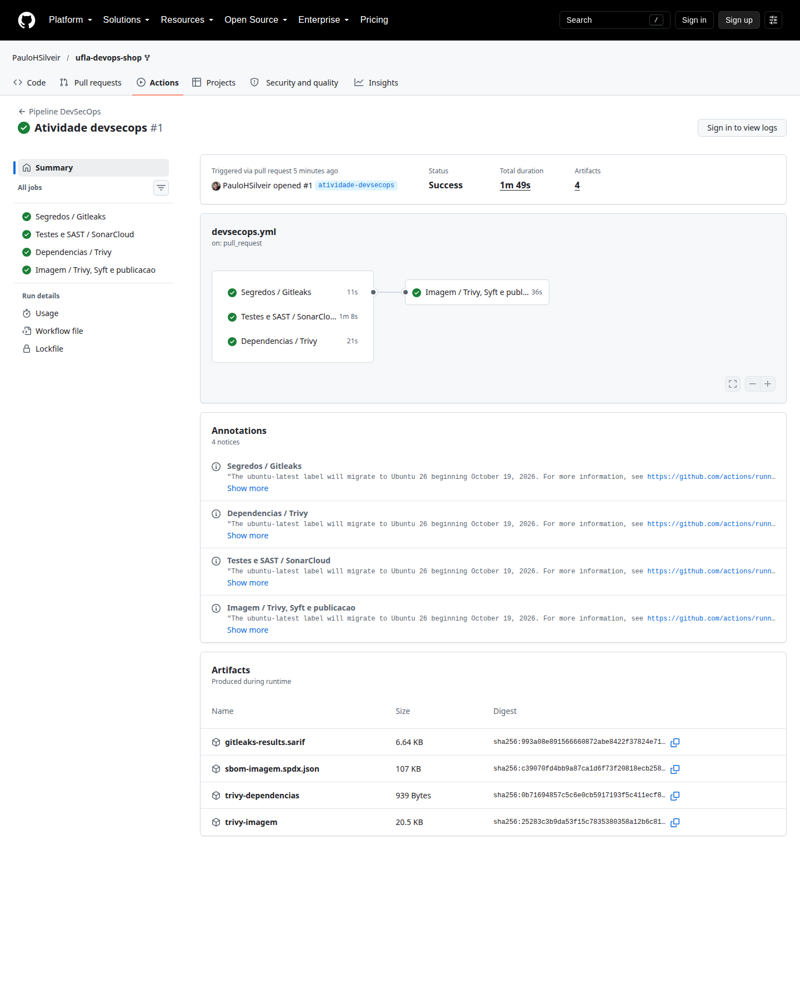
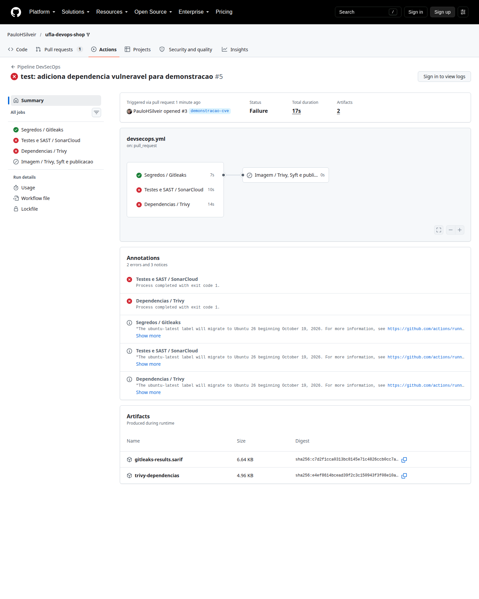
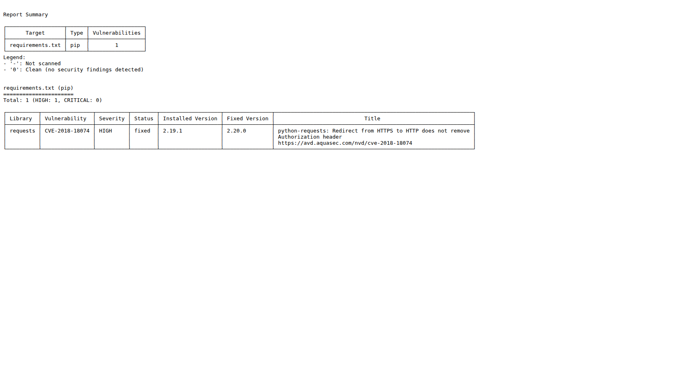
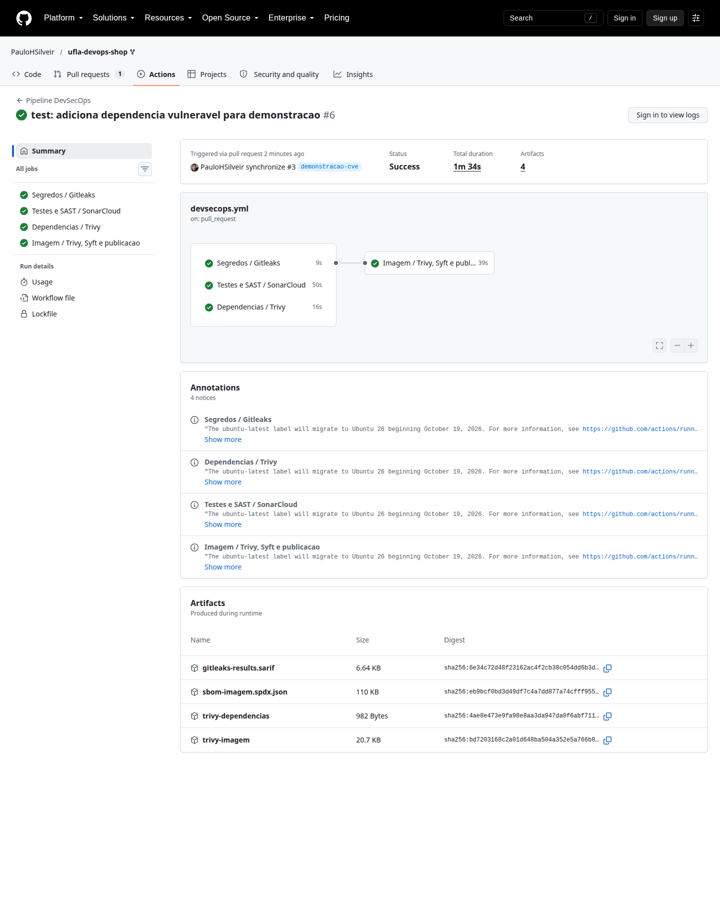

# Evidências do pipeline DevSecOps

## Execução inicial aprovada

A primeira execução do workflow no Pull Request 1 concluiu com sucesso os
checks do Gitleaks, SonarCloud, Trivy e Syft. A página também apresenta os
artifacts `trivy-dependencias`, `trivy-imagem` e `sbom-imagem.spdx.json`.

[Abrir execução no GitHub Actions](https://github.com/PauloHSilveir/ufla-devops-shop/actions/runs/40622212700)

## Bloqueio da dependência vulnerável

No Pull Request 3 foi adicionada a dependência `requests==2.19.1`. A execução
falhou no check `Dependencias / Trivy`, e o job da imagem foi impedido de
iniciar.

[Abrir Pull Request bloqueado](https://github.com/PauloHSilveir/ufla-devops-shop/pull/3)

[Abrir execução bloqueada](https://github.com/PauloHSilveir/ufla-devops-shop/actions/runs/40623594841)

O relatório do Trivy identificou a vulnerabilidade `CVE-2018-18074`, de
severidade `HIGH`, na versão `2.19.1` do pacote `requests`. O próprio relatório
indica a versão `2.20.0` como primeira versão corrigida. A captura abaixo foi
gerada localmente com o mesmo comando e a mesma base de vulnerabilidades usados
pelo workflow; o relatório JSON da execução também está disponível no artifact
`trivy-dependencias`.

## Correção

No mesmo Pull Request, a dependência foi atualizada para `requests==2.34.2`. A
nova execução concluiu com sucesso os quatro jobs obrigatórios: Gitleaks,
SonarCloud, Trivy para dependências e Trivy/Syft para a imagem.

[Abrir execução aprovada após a correção](https://github.com/PauloHSilveir/ufla-devops-shop/actions/runs/40624436173)

A execução corrigida publicou quatro artifacts, incluindo os relatórios do
Trivy e o arquivo `sbom-imagem.spdx.json`. O Pull Request de demonstração não
deve ser mesclado, pois a aplicação não utiliza a biblioteca `requests`.
